<!--
  Every image under assets/ is drawn by scripts/render.py (stdlib Python, no third-party cards)
  and re-rendered every 6 hours by .github/workflows/profile.yml from live GitHub data —
  except assets/ember.svg, drawn from the pet's own art code in the (private) Claude Code harness.
  The look: monochrome luxe. Black and warm white, one gold accent, a didone for display type.
-->


<!-- INTRO FILM: in GitHub's web editor, drag the exported MP4 onto this line; GitHub turns it into a player -->

<h3>01 &nbsp;·&nbsp; About</h3>


<b>The rules my systems are built on</b>

 

| # | Principle | What it means in code |
|---|-----------|-----------------------|
| 01 | **A clean build is not verification** | Execute the path: load the page, call the function, run the agent |
| 02 | **Report the number, not the adjective** | "23 of 24 pass at 4.5:1" beats "contrast is fine" |
| 03 | **Guardrails live in code, not prompts** | Writes to production are rejected at parse time, not discouraged |
| 04 | **A test against a mock proves the mock** | Fixtures take their shape from the code that produces the data |
| 05 | **Fail closed** | When a check can't decide, the action doesn't happen |
| 06 | **Humans approve the irreversible** | Agents propose; people sign off on writes and self-modification |

<h3>02 &nbsp;·&nbsp; Selected builds</h3>

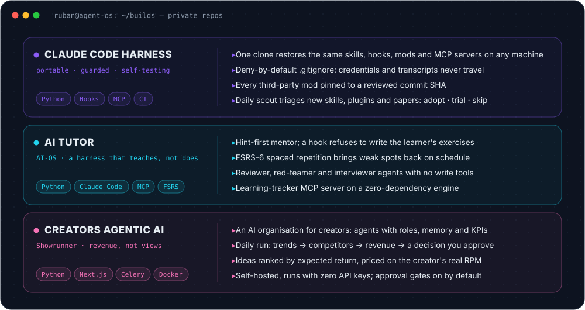

Three systems I build alongside AURA. The repos are private, so this panel describes what each one does.


<b>Ember</b> lives in my Claude Code harness: an anime samurai that floats over my desktop and shows, live, what Claude is doing. It shows the running tool, the plan's progress, and session, weekly and context use, on a liquid-glass panel. When Claude needs me, it says so. Original character, drawn in code.

<h3>03 &nbsp;·&nbsp; AURA</h3>

**[AURA](https://github.com/RubanSivanandam/Agentic-Unified-Reasoning-Architecture)** lets you ask your company's data questions in plain English and **see exactly how the AI reached every answer**. It runs on a laptop with no GPU, works with any model you bring a key for, and your data stays on your machine.

<a href="https://github.com/RubanSivanandam/Agentic-Unified-Reasoning-Architecture">
</a>
<a href="https://github.com/RubanSivanandam/Agentic-Unified-Reasoning-Architecture/blob/main/CHANGELOG.md">
</a>

Earlier public work (2024): [NodeJS_JWT](https://github.com/RubanSivanandam/NodeJS_JWT) · [NodeJS_CRUD_Backend](https://github.com/RubanSivanandam/NodeJS_CRUD_Backend) · [NodeJS_CRUD_Postgresql_MongoDB](https://github.com/RubanSivanandam/NodeJS_CRUD_Postgresql_MongoDB) · [Angular-17-FrontEnd](https://github.com/RubanSivanandam/Angular-17-FrontEnd)

<h3>04 &nbsp;·&nbsp; Pattern of the day</h3>


<h3>05 &nbsp;·&nbsp; Stack</h3>


<h3>06 &nbsp;·&nbsp; Recently</h3>

<!--ACTIVITY:START-->
- `2026-10-19` ⚡ pushed to [RubanSivanandam](https://github.com/RubanSivanandam/RubanSivanandam)
- `2026-10-16` ⭐ starred [rea](https://github.com/morluto/rea)
- `2026-10-12` ⚡ pushed to [RubanSivanandam](https://github.com/RubanSivanandam/RubanSivanandam)
- `2026-10-07` ⚡ pushed to [RubanSivanandam](https://github.com/RubanSivanandam/RubanSivanandam)
- `2026-10-07` 🌱 created branch `main` in [RubanSivanandam](https://github.com/RubanSivanandam/RubanSivanandam)
<!--ACTIVITY:END-->

<b>Telemetry</b> — public GitHub activity (most of my work lives in private repos)

 


<picture>
  <source media="(prefers-color-scheme: dark)" srcset="https://raw.githubusercontent.com/RubanSivanandam/RubanSivanandam/output/github-snake-dark.svg" />
  <source media="(prefers-color-scheme: light)" srcset="https://raw.githubusercontent.com/RubanSivanandam/RubanSivanandam/output/github-snake.svg" />
  
</picture>


